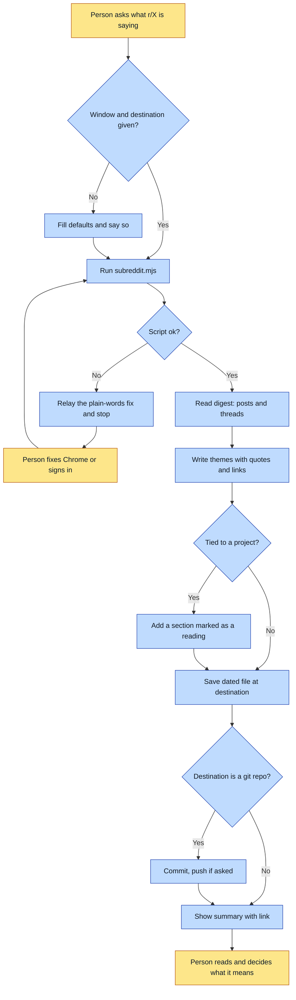

# Purpose
A person knows what a Reddit community said over a stretch of time, in a short summary of voices with a link to every thread, saved where they keep such things.

# When to use (Trigger)
Someone asks what a subreddit is saying or said ("what are people saying on r/eink this month", "read r/daylightcomputer for two weeks"), or types `/read-a-subreddit`.

# Inputs / Prerequisites
- The subreddit, a time window, and where to save. Defaults: the past 30 days; the person's notes folder.
- Node 18+, OpenCLI (`npm install -g @jackwener/opencli`), and a windowed Chrome OpenCLI can reach: its extension, or `OPENCLI_CDP_ENDPOINT`.
- No Reddit account for public subreddits.

# Roles
| Role | Responsibility |
|---|---|
| **Human operator** | Names the community, the window and the destination; reads the summary; decides what it means for their own work; decides anything that would be posted back to Reddit (this skill never posts). |
| **Agent executor** | Fills defaults and says so; runs the script; reads the digest; writes themes with quotes and links; saves, commits, pushes where that destination is always pushed; shows the summary. |

# Procedure
1. Read the subreddit, window and destination from the request. If the window is missing, use the past 30 days. If the destination is missing, use the notes folder, or ask once when there is none. Say which defaults were used.
2. Run `scripts/subreddit.mjs r/<name> --days <N> --threads 12`. If it stops with an error, relay its plain-words fix and stop: no browser reachable, a sign-in needed, or a block page from headless Chrome.
3. Read `digest.md`: every post in the window, then the most-discussed threads with their comments.
4. Write four to six themes, each with short quotes and links, ordered by what the community cared about most. If the person tied it to a project, add a final section labeled as a reading, not a finding. Include the coverage note if the script printed one.
5. Save as `YYYY-MM-DD-r-<name>-<window>.md` at the destination. If the destination is a git repository, commit; push when the person asked for it to go there.
6. Show a shorter version in the chat with a named link to the file.

# Process Flowchart
Amber = irreducibly human. Blue = agent-executed or agent-proposed.

# Done / Verification
- A dated file exists at the destination. Every theme links to at least one thread, and there are no usernames.
- If the destination is a git repository, the commit is there (and on the remote when pushed).
- The chat shows the summary and a named link to the file.
- The script's own tests pass: `node --test scripts/subreddit.test.mjs` (10 tests, real OpenCLI output as fixtures).

# Exceptions & Troubleshooting
- **"OpenCLI cannot reach Chrome" (exit 69):** open Chrome with the OpenCLI extension enabled, or set `OPENCLI_CDP_ENDPOINT`.
- **"Nothing is listening at OPENCLI_CDP_ENDPOINT":** that Chrome is not running. On a Freedom machine, `agent-chrome-quiet` starts it behind your windows.
- **Block page / "not valid JSON":** the Chrome is headless. Use a windowed one.
- **Sign-in required (exit 77):** a private or age-gated subreddit. The person signs in to reddit.com in that Chrome once.
- **Busy subreddit:** the newest 100 posts may not reach back across the whole window. The script says so in a coverage note, and older quiet posts appear only if they made the top 60.
- **A thread will not load:** the digest lists it as "Could not read". The run continues.
- **A topic, not a community:** find the subreddit first. Searching all of Reddit sorted by top returns viral posts that only share a word.

# Automation Opportunities
- **Already runs:** fetching, windowing, choosing threads, reading comments, stripping usernames, writing the digest (`scripts/subreddit.mjs`).
- **Strongest next candidate:** a scheduled monthly read of a community someone follows, saved straight to its folder, so the summary is waiting rather than requested.
- **Must stay human:** deciding what the voices mean for one's own work, and anything said back to the community. A summary is a reading of a dozen people, and acting on it is a judgment call.

# Related
- `agent-reach`: installs OpenCLI and the other readers this depends on.

# Revision History

| Version | Date | Changes |
|---|---|---|
| 0.1 | 2026-10-05 | Initial draft, from two runs by hand on 2026-10-05 (r/daylightcomputer, r/eink). |
